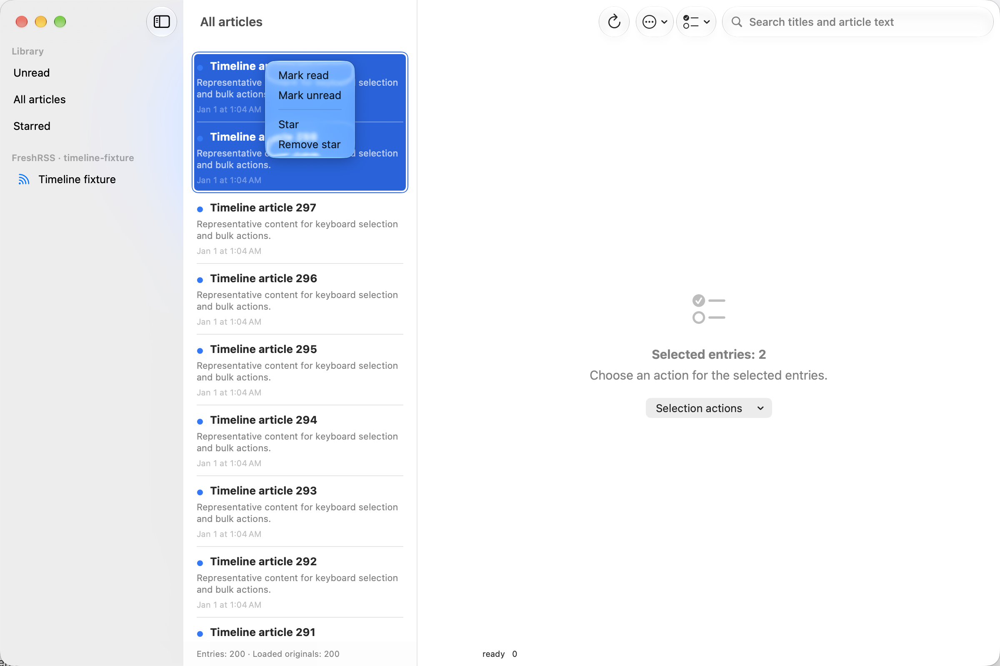

# D / #49: Mac query and selection contracts — 2026-10-25

Continue the existing ReaderUI. B is accepted; C's exercised core and real Mac/server round trip are proved, while its actual offline/device tail remains explicitly deferred by the owner. D verification now focuses on Mac. No legacy code or foreign change is removed.

| Criterion | Status | Evidence and remaining work |
|---|---|---|
| A→B→C reordered queries display only C | Fulfilled on Mac | The bounded QueryGate releases C before B/A and checks both articles and rendered rows. The feed-action follow-up proves native input/scrolling while feed/search requests remain held and passes hosted run 40199383420. #12 is accepted for the Reader replacement. |
| Every different query has a distinct task key | Fulfilled locally | Two cases reproduce the initial nil/unread collision and a selection/search separator collision. A typed ReaderQueryIdentity preserves the two fields independently. A real-store contract marks one article read, verifies three initial rows, then requires a new Unread task key and exactly two unread rows. |
| Late detail work cannot replace current state | Fulfilled locally | Four controlled cases cover newer success, older error, cancellation and an A→B→A selection transition. The fixture models an already-running store lookup that completes after caller cancellation. Result/error publication requires the latest detail generation, matching selection and a noncancelled task. |
| Menu creation performs no article query; confirmed action affects exactly current unread articles on Mac | Fulfilled locally | [Feed-action evidence](d-feed-read-2026-10-25.md) proves cached menu identity, unchanged lookup/call/outbox counts before confirmation and exactly one confirmed 300-article command beyond the loaded 200-row page. Four code functions / six cases verify exact unread/account/feed/revision/arrival semantics. #41 retains its deferred iOS acceptance. |
| Mac multi-selection in version one | Fulfilled on native Mac | Owner-approved selection set, aggregate detail, shared read/unread and star/unstar actions. Five code functions / nine cases verify selection reconciliation, captured keys, frozen digest revisions, deduplication, mixed-star rejection and zero preparation lookups. A native UI run at 14-34-13 proves Shift-Down selects two rows, the context menu queues exactly two read changes and Down restores single selection. |
| Selection, search, ordering and counters remain consistent after changes on Mac | Fulfilled locally | [State follow-up](d-state-2026-10-25.md) verifies fresh off-page source selection, ordinary read/unread/star/unstar/filter/search transitions and digest badges/visible-vs-original counts. The existing native case additionally proves zero Unread counts and cleared detail after the 300-article action. |
| Current native full plan / hosted checkpoint | Fulfilled on Mac | State-follow-up raw full-plan summary proves 126 code functions plus the same five UI tests / 207 executions. Reader Mac CI 40200513298 passes at 410887e7c. Preserve the earlier full-plan initialization failure and invalid inline 183-pass report. |
| README | Updated | ReaderUI and project guides describe typed query identity, independent detail generations and exact remaining D acceptance. |

## Reproduced failures and repair

The old queryIdentity concatenated selection and search with a pipe, using unread for a nil selection. A nil selection actually queried all articles, so switching to the first Unread selection did not change SwiftUI's task key. Pipe-containing selection/search combinations could also collide. ReaderQueryIdentity is now an immutable Hashable/Sendable value with separate optional selection and search fields; no string parsing or invented separator is needed.

loadSelectedArticle previously checked only the article key. Two requests for the same key could finish out of order, an old error could replace newer success, and an already-running request could publish after cancellation or A→B→A selection. It now has an independent generation, invalidated by real selection changes and each new detail request, plus cancellation checks on both results and errors. The displayed digest revision contract is preserved.

Before repair, the ReaderSession suite passes its ten existing cases and fails all seven added cases at:

`/var/folders/b5/h7f8ws9x5cj4_5n6rtgypdhh0000gn/T/ActionArtifacts/default/RunSomeTests/Test-Reader-2026.10.25_13-27-21-+0100.xcresult`

The repaired suite passes all 17 executions at `RunSomeTests/Test-Reader-2026.10.25_13-28-25-+0100.xcresult` under the same ActionArtifacts root. The earlier generated Swift Testing diagnostic around allSatisfy with a key-path expression was a build failure, not runtime evidence; an equivalent closure preserves the assertion. Compiler policy is unchanged.

## Query/detail checkpoint verification

The query/detail checkpoint at **fa7740dc6** is confirmed by [Reader Mac CI 40197607594](https://github.com/mpwg/NetNewsWire/actions/runs/40197607594): code tests, all three then-existing UI tests, process recovery and runner contracts pass. The local failures below remain historical evidence and are not relabeled as successful.

The native Mac full-plan action through Xcode MCP passes **114 Swift Testing functions / 180 code executions**. Raw original summary confirms 21 parameterized functions / 87 cases, no code failures/skips/expected failures and no runtime warnings. Its UI runner fails to initialize with Timed out while enabling automation mode, before any UI method executes. Overall result is Failed, with 114 passed distinct tests plus one synthetic runner error. Authoritative bundle:

`/Users/mat/Library/Developer/Xcode/DerivedData/Reader-fuevgxanyutuuihcfejpioljllaa/Logs/Test/Test-Reader-2026.10.25_13-30-43-+0100.xcresult`

The MCP inline summary claims 183 passes and includes the three UI entries despite the raw runner failure. Both original and exported xcresult summaries contradict it. Keep the [raw failed summary](d-native-failed-2026-10-25.json) and do not infer XCTest permission, lock-screen or product failure from this initialization error.

A single fresh UI-suite run, without source/compiler changes, passes all three unchanged methods. Its raw original summary confirms three passes, zero failures/skips/expected failures:

`/Users/mat/Library/Developer/Xcode/DerivedData/Reader-fuevgxanyutuuihcfejpioljllaa/Logs/Test/Test-Reader-2026.10.25_14-22-39-+0100.xcresult`

This verifies the UI suite separately; it does not turn the failed initial full-plan action green. The current evidence is 180 passing code executions and three separately passing UI executions, with hosted full-plan confirmation still pending.

Whole-repository SwiftLint strict and diff checks pass. At this initial query/detail step, hosted revalidation was pending and the three UI tests retained their existing first-window/sheet/image-load scope. They did not prove native D timeline/menu/keyboard acceptance. Subsequent hosted confirmation and native selection/feed scenarios are recorded separately below; no simulator or real-account mutation was introduced by these D fixtures.

The review uses modernize-tests, acceptance-completion and Apple's swiftui-specialist/SwiftUI-27 references. Reader's scoped source has no UIKit shared-screen/orientation/application access to migrate; excluded legacy controllers are preserved. Real offline, separate devices, broad accessibility, PCC and the separately tracked Swift CodeQL tracer failure retain their explicit scope.

## Owner-approved Mac multi-selection follow-up

The Mac timeline now binds a Set of stable TimelineSelection identities to Apple's List. The single-selection adapter still supports article/source navigation. Multiple selected rows show an aggregate detail instead of picking an unordered primary item. Apple's selection-based context menu supplies the actual target set, including a secondary click on a selected row. The toolbar exposes the same actions. No new custom gesture recognizer, selection keyboard handler or shortcut replaces standard Mac behavior.

Each action captures an immutable TimelineStatusTarget from cached snapshots. A later selection change cannot redirect the queued command. Digest revisions stay fixed while their selection is retained, new sources are excluded, and shared source keys are deduplicated. Digest-containing targets reject star actions both in the menu and the command boundary. A changed published query clears selection; a refresh intersects timeline-origin selections with visible rows. Explicit source navigation outside the loaded page remains supported.

The focused suite passes **18 Swift Testing functions / 26 executions** at 14-32-20. The five added functions cover nine executions and use real isolated ReaderStore instances. No UI test is used to duplicate those state contracts. Build-for-testing, strict SwiftLint and diff checks pass with existing compiler policy.

The additional native UI test uses a Debug/Mac-only, in-memory 300-article fixture and the shipping Reader views/store. It selects the first row, extends via Shift-Down, opens the actual context menu and chooses Mark read, observes exactly two pending read changes in the real store, then uses Down to restore single selection. It contacts no external server and opens no persistent user store. The first run at 14-33-55 fails because its assertion inspects label instead of the observed StaticText value; the application already exposes Selected entries: 2. Correcting the accessibility query, with no product change, passes at 14-34-13. Both outcomes are retained. The raw original green bundle is:

`/Users/mat/Library/Developer/Xcode/DerivedData/Reader-fuevgxanyutuuihcfejpioljllaa/Logs/Test/Test-Reader-2026.10.25_14-34-13-+0100.xcresult`

The current full native Mac plan passes **119 Swift Testing functions plus four UI tests / 193 executions**. The [versioned raw summary](d-multiselection-native-2026-10-25.json) confirms 123 distinct tests, 23 parameterized functions / 93 cases, zero failures/skips/expected failures/runtime warnings. Original bundle:

`/Users/mat/Library/Developer/Xcode/DerivedData/Reader-fuevgxanyutuuihcfejpioljllaa/Logs/Test/Test-Reader-2026.10.25_14-34-52-+0100.xcresult`

This fulfills the requested Mac selection/bulk-edit behavior. [Reader Mac CI 40198424536](https://github.com/mpwg/NetNewsWire/actions/runs/40198424536) passes at **c8c133cdc** with all 119 code functions in 19 suites, all four UI tests, recovery and runner contracts. D and #12/#41 remain open at that checkpoint for confirmed bulk-feed read, native input during a held database request, wider state/counter checks and final deferred platform acceptance. Later feed-action evidence is recorded separately.
