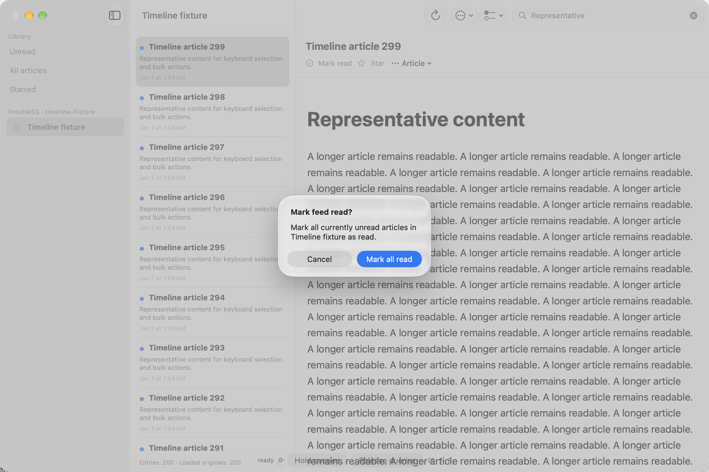

# D / #49: confirmed feed read and native delayed-query input — 2026-10-25

This follows Mac multi-selection checkpoint c8c133cdc. [Reader Mac CI 40198424536](https://github.com/mpwg/NetNewsWire/actions/runs/40198424536) passes that checkpoint's 119 code functions, four UI tests, process recovery and runner contracts. The current step stays in D, uses the existing Reader, and preserves all legacy/user changes.

| Criterion | Status | Evidence |
|---|---|---|
| Menu availability uses cached selection/feed state | Fulfilled on Mac | ReaderSession.feedForStatusAction resolves cached TimelineRow.feed identities only. The code lookup counter remains unchanged across repeated selection/menu preparation. The native scenario opens the timeline menu and confirmation while a real repository request is held; lookup count stays fixed. |
| Only confirmation requests the current unread set | Fulfilled on Mac | The native confirmation exposes zero feed-read calls and zero pending changes before action; Cancel writes nothing. Confirmation calls the repository exactly once and queues 300 read changes beyond the 200-row loaded page. |
| Exact account/feed scope and atomic persistence | Fulfilled in code contracts | ReaderStore validates the subscribed feed, fetches its current unread keys and writes read/outbox revisions in one actor-owned transaction. Cases with 0, 1 and 405 articles verify another feed/account stays unchanged, existing read revisions retain their UUIDs, and a repeated command creates no status revisions. |
| Before/after arrivals, failure and cancellation | Fulfilled in code contracts | A real-store session test captures menu feed identity, receives another article, then confirms all 406 current unread entries. An arrival after commit remains unread. Removed feeds preserve protected originals/outbox; a pre-cancelled command makes no write. |
| Native input during an asynchronous feed transition | Fulfilled locally on Mac | Native sidebar feed change and search requests are deliberately held at the repository boundary. The last consistent rows/detail remain visible. The actual FreshRSS sheet accepts text, scrolling completes, and the timeline menu/confirmation remains usable before release. |
| Scroll/multi-selection and stale responses | Fulfilled locally on Mac | The separate native selection test proves Shift-Down/shared read/Down. Controlled ReaderSession tests prove A→B→C rejection. Both use the shipping session/view/store path, with synthetic isolated data. |
| Full current local plan | Fulfilled | Original raw summary at 14-45-52 confirms 123 code functions plus five UI tests / 200 executions, 24 parameterized functions / 96 cases, zero failures/skips/runtime warnings. |
| Hosted confirmation | Fulfilled | [Reader Mac CI 40199383420](https://github.com/mpwg/NetNewsWire/actions/runs/40199383420) passes at 350e32eea: 123 code functions in 20 suites, all five native UI tests, process recovery and runner contracts. #12 is closed as accepted for the Reader replacement. |
| iPhone/iPad / actual offline / broader accessibility / PCC | Open | Deferred final platform verification and owner-deferred network-off scope remain separate. No claim of physical-device, VoiceOver, PCC or real-server coverage is made by these fixtures. #41 stays open for its iOS scope. |
| README | Updated | ReaderUI and ReaderPersistence document the confirmed capability, transaction semantics and native/code-test boundary. |

## Implementation boundary

Timeline rows retain a cached feed identity. Sidebar and timeline menus present the native SDK-27 item-based confirmation. They do not obtain an article collection to decide availability. ReaderSession prevents duplicate in-flight commands for one feed, then awaits the explicit asynchronous ReaderRepository.markFeedRead capability. Unsupported stores fail explicitly; there is no paged-query fallback that could capture a stale subset.

ReaderStore selects and updates the current unread set in one transaction without suspension. Existing status/outbox code is shared through updateStatus, preserving rollback and exact pending revisions. Only the account affected by changed keys is flushed after the local commit. Articles arriving while the menu was open are included; those arriving after the transaction are excluded. The command reads all affected keys only after confirmation, outside MainActor.

## Code evidence and preserved initial failures

Four added Swift Testing functions execute six cases, using isolated real ReaderStore instances. Native code-test execution through Xcode MCP at 14-40-11 initially fails five cases because concrete store calls resolve the protocol's asynchronous default instead of the synchronous overload. The explicit asynchronous store signature removes that ambiguity. The sixth failure is a fixture selecting article IDs outside the loaded first page; selecting the actual visible rows retains the intended confirmation contract. No assertions are skipped or weakened.

The repaired focused ReaderFeedReadTests/ReaderStoreTests/ReaderSessionTests run passes **57 executions** at 14-40-26:

`/var/folders/b5/h7f8ws9x5cj4_5n6rtgypdhh0000gn/T/ActionArtifacts/default/RunSomeTests/Test-Reader-2026.10.25_14-40-26-+0100.xcresult`

The earlier red bundle has suffix 14-40-11 under that same root. Existing rollback/status contracts also exercise the shared write helper. Strict SwiftLint and diff checks pass with Approachable Concurrency and warnings-as-errors unchanged.

## Native Mac observation

The additional native XCTest case uses the Debug/Mac-only in-memory 300-article fixture. The instrumented repository forwards shipping operations to ReaderStore and exposes explicit hold/release control for list requests. AsyncStream continuations hold requests without blocking MainActor and are removed on cancellation/release. The scenario performs a real sidebar feed switch, enters search, types in the account sheet, scrolls, opens the item-based timeline menu, cancels once and then confirms once. It observes actual store outbox changes. No external HTTP, Keychain or persistent personal store is used.

The 14-41-48 run fails because a global article-title query clicks the identically titled detail instead of the timeline; the 14-43-13 run then reaches confirmation but its global Cancel query matches Touch Bar. Scoping to the actual outline/window fixes the tests without changing product behavior. Both failures remain recorded; neither proves a product/permission fault.

The native 14-44-36 run passes with no failures/skips/runtime warnings, verified from its original raw summary:

`/Users/mat/Library/Developer/Xcode/DerivedData/Reader-fuevgxanyutuuihcfejpioljllaa/Logs/Test/Test-Reader-2026.10.25_14-44-36-+0100.xcresult`

The kept attachment records lookup count 20 before confirmation, feedReadCalls=0 and pending=0, followed by exactly one confirmed call and 300 pending read changes. The final full plan additionally asserts the lookup count after Cancel and the held-query count after native form input.

The final full native plan passes **123 Swift Testing functions plus five UI tests / 200 executions**, including the additional post-Cancel lookup and post-input held-query assertions. The [versioned raw summary](d-feed-read-full-native-2026-10-25.json) confirms 128 distinct tests, 24 parameterized functions / 96 cases and zero failures/skips/expected failures/runtime warnings. Authoritative original bundle:

`/Users/mat/Library/Developer/Xcode/DerivedData/Reader-fuevgxanyutuuihcfejpioljllaa/Logs/Test/Test-Reader-2026.10.25_14-45-52-+0100.xcresult`

This is native functional evidence, not a general latency/energy benchmark. Full D state/counter consistency and final platform acceptance remain open. No legacy code is removed.

## Hosted acceptance and issue scope

Hosted job 121187101467 confirms all 123 Swift Testing functions in 20 suites and all five native UI cases, including delayed-query input/confirmation and keyboard multi-selection. The current [Reader run](https://github.com/mpwg/NetNewsWire/actions/runs/40199383420) and artifact 12601646928 are successful. Runner failure-propagation contracts and the 10,000-article SwiftData SIGKILL/reopen probe also pass.

Every requirement of the Mac-specific #12 replacement contract is now fulfilled: asynchronous ordinary feed transitions, last consistent state/loading, generation rejection, native input/scrolling and retained multi-selection behavior. It is closed with these concrete code/native/hosted references. This does not reaccept or remove the original controllers. #41 remains open for its explicitly deferred iOS scope, and #49 remains open for the remaining state/error/counter and final-platform checks. The separate dynamic Swift CodeQL tracer failure remains tracked in #56; Reader test success is not a repository-wide security-analysis result.
