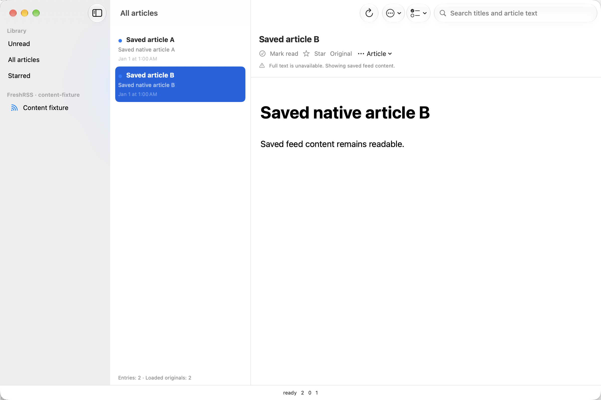
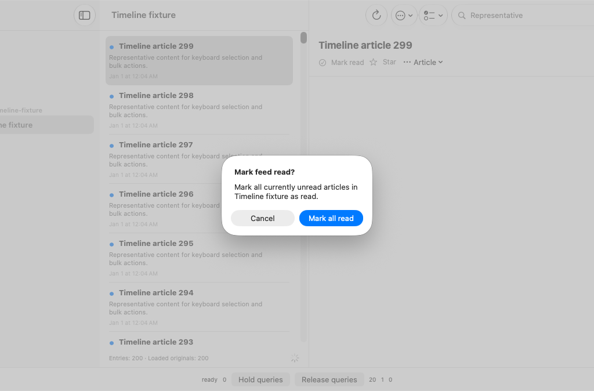

# F / #51: native WebKit and article component evidence — 2026-10-25

This continues the [extraction publication checkpoint](f-extraction-2026-10-25.md) on the existing native Reader. Interactive authoring, builds and test execution use Xcode MCP. MacBook Pro arm64, macOS 27.0.1 (26A434), Xcode 27.1 / Swift 6.4, My Mac Debug. No physical-device or actual network-off result is implied.

## Test boundaries

The current full plan passes **151 Swift Testing functions / 262 executions and seven native UI methods / executions**: 158 distinct tests, 269 executions, 43 parameterized functions / 154 cases, no failures, skips or runtime warnings. [Original raw summary](f-rendering-full-native-2026-10-25.json). The original authoritative bundle is `/Users/mat/Library/Developer/Xcode/DerivedData/Reader-fuevgxanyutuuihcfejpioljllaa/Logs/Test/Test-Reader-2026.10.25_17-16-21-+0100.xcresult`.

This step adds eight Swift Testing functions / 21 executions and exactly one UI method. Pure unit tests remain appropriate for business rules. The native components below need their actual frameworks but do not need XCUIAutomation:

- Five ReaderWebPageTests functions / eleven executions load the shipping document wrapper and actual WebPage. They verify saved HTML, literal plain text, malformed saved markup, relative links, decoded 80×40 inline SVG images and disabled content JavaScript. The script-policy test deliberately omits CSP and requests JavaScript in the supplied configuration; the shipping factory still disables it. Test-owned `callJavaScript` inspects DOM state without enabling page scripts.
- Three WebPage outcomes use an actual custom URLSchemeHandler: completed navigation, failed resource and active cancellation. The resource producer observes cancellation while its gate is held; page, handler and server weak references subsequently disappear.
- One Mac ReaderArticleViewTests function / four executions mounts the shipping ArticleDetailView in an actual NSWindow/NSHostingView. Its task uses the real ArticleContentService, ReaderStore and isolated URLSession transport. Success updates the WebKit document; HTTP 403 and unrecoverable markup preserve saved content; removing the active view cancels its held HTTP request without an alert or store/outbox mutation. After removal, nine weak references disappear: article state, WebPage, hosting view, session, services, content service, store, transport and server. Assertions precede fixture cleanup so teardown cannot satisfy the cancellation criterion.
- Two ContentTests functions / six executions cover complete fragment normalization and explicit unavailable-content errors. The existing twenty extraction executions retain stale-delivery, generation, error and cancellation coverage.

The focused component/content/extraction/lifetime run at 17-16-01 passes all fifty executions. The two new app fixture files were subsequently moved through Xcode MCP into the existing synchronized app folder; Xcode removed their explicit file/source references. The unchanged sources build for testing successfully at 17-22-21. No project-file edit or generation was required. Strict whole-repository SwiftLint and `git diff --check` pass.

## Reproduced defects and corrections

The initial hosted-component success case retained saved text. [First failure](f-native-view-red-2026-10-25.json) and [diagnostic failure](f-native-view-diagnostic-red-2026-10-25.json) identify the parser's `invalidResponse` for a complete bare article fragment. The initial loading-state-race hypothesis was not established and is not claimed as the repair.

JSDOMParser does not create the missing document/body structure that Readability expects. Reader's adapter now adds that structure while preserving the head and existing content. [Fragment red result](f-fragments-red-2026-10-25.json). Complete article/body/head-without-body/plain-text fragments then extract with relative links resolved. Vendored parser sources and their license remain unchanged.

Empty or severely unclosed markup can produce JavaScript null. Previously JSON decoding exposed an internal DecodingError; [red result](f-unavailable-content-red-2026-10-25.json). The adapter now reports the existing localized unavailable-content error before decoding. This proves graceful fallback, not universal recovery of malformed HTML.

## Actual app interaction and visible fallback

Exactly one new native UI scenario starts extraction for A through the real article menu, selects B and requires A's transport cancellation. B then returns HTTP 403; the test dismisses the actual alert and verifies the warning and saved WebKit heading are hittable. The fixture requires both Debug/Mac launch flags, uses two synthetic in-memory articles and creates no account client or Keychain access.

The first attempt selected a Touch Bar OK button. [Query failure](f-native-app-query-red-2026-10-25.json). Scoping OK to the actual window fixes the query; the focused scenario passes at 17-14-28 and again in the complete plan. No shipping alert behavior was changed to accommodate the test.

This is an actual application-window screenshot. Experimental NSView cache captures omitted or retained compositor layers; they were rejected, their recording helper removed, and they are not acceptance evidence.

## Initial hosted run and small-display correction

[Reader CI 40211531923](https://github.com/mpwg/NetNewsWire/actions/runs/40211531923) at a9a2c7b27 passes all 151 Swift Testing functions in 25 suites, runner bootstrap, 10,000-article recovery and strict lint. Five UI methods pass, including the new extraction scenario; two existing UI methods fail. This is a failed overall Reader run: [raw summary](f-first-ci-native-2026-10-25.json), 267 passed / two failed executions.

The delayed-query scenario cannot hit Unread at x=-72; the window scenario cannot hit the first window's close button. The captured native app image shows the 1200-point initial window clipped on the runner's 1024-point display, including its left sidebar/title-bar area:

The follow-up caps new Mac windows to the SwiftUI placement context's visible display rectangle, leaving edge space, while retaining the preferred maximum 1200×800 size and normal user restoration/resizing. It uses defaultWindowPlacement and context.defaultDisplay, following Apple's current SDK documentation; no global screen lookup or test-only geometry override is added. The UI assertions remain intact. Native build-for-testing and strict lint pass; both affected UI scenarios pass through Xcode MCP at 17-33-43, [raw summary](f-window-placement-native-2026-10-25.json). Fresh hosted revalidation on the smaller display is pending. This geometry correction requires actual native window evidence, rather than a unit test that repeats its size calculation.

## Criterion matrix

| Criterion | Status | Evidence and boundary |
|---|---|---|
| Late success/failure cannot change the current article | Fulfilled on exercised Mac core | Existing twenty Swift Testing extraction executions retain the precise after-parsing delivery gate, A→B→A and cancellation without replacement. Native selection additionally cancels A's active transport. |
| Removed article view and extraction graph release | Fulfilled on Mac component | Actual NSHostingView/ArticleDetailView removal, success/failure/malformed/held-cancellation, nine weak references released. Actual WebPage/handler/server release covers three navigation outcomes. |
| Restricted page preserves usable saved content | Fulfilled on exercised Mac | Actual app menu/selection, HTTP 403 alert, visible warning and readable saved heading; malformed-content component fallback. |
| Relative links, plain text, malformed markup and script policy | Fulfilled for named fixtures | Actual WebKit DOM/image assertions; four complete parser fragment forms recover and two unavailable forms fail explicitly. Existing HTTP timeout contract remains passing. |
| Real network-off/restart | Open | Owner explicitly deferred this Mac run. Synthetic documents/transports do not replace it. Do not re-request until resumed. |
| Representative real-site/media and resource acceptance | Open | Broader real pages/media, sustained memory/energy and the 4 MB check after response buffering remain separate; there is no streamed download memory bound. |
| Final platforms and accessibility | Open | iPhone/iPad, physical-device signing and broad accessibility remain deferred/unavailable. |
| README, matrix and hosted confirmation | Open for hosted run | Reader, ReaderKit, ReaderUI and root guides, matrix, handoff and test review are updated. Local checks pass; exact-head Reader CI must still confirm this checkpoint. |

F and #33/#34 remain open for their deferred criteria. Native Mac lifetime/rendering evidence is now present; previous native-gap statements describe the earlier extraction-only checkpoint.

Separate [CodeQL run 40211531653, Swift job 121223603838](https://github.com/mpwg/NetNewsWire/actions/runs/40211531653/job/121223603838) fails in Autobuild with preload_tracer exit 139 before analysis. Python, JavaScript/TypeScript and Actions jobs pass. [Exact current error excerpt](f-codeql-2026-10-25.txt). K retains this failure; no check is disabled and Reader test success is not complete repository CI acceptance.
